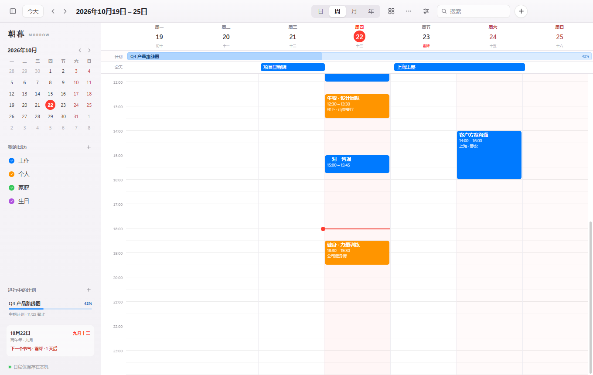

# Morrow · 朝暮


[](../../releases/latest)

> *Morrow* — the next day, the morning light.

[中文](README.md) · [Offline HTML manual](README.html)

**Morrow (朝暮)** is a macOS-inspired desktop calendar for Windows: month, week, day and year views, drag-to-create events, color-coded calendars, instant search, and four draggable desktop widgets. Local-first, crafted with Electron and vanilla JavaScript.


## Download

Get the latest Windows installer from **[Releases](../../releases/latest)**:

```text
朝暮-Morrow-Setup-1.0.0.exe
```

- Windows 10 / 11, x64
- Per-user installation; no administrator privileges required
- Desktop and Start Menu shortcuts are created automatically
- Uninstall from Windows Settings; your calendar data is preserved
- The build is unsigned. If SmartScreen appears, choose **More info → Run anyway**

> The installer is about 107 MB. It is attached to GitHub Releases instead of being committed to the repository.

## Features

- **Four views** — month, week, day and year, with today highlighting, cross-month and all-day events.
- **Event management** — create, edit and delete events with calendar, start/end time, all-day flag, location and notes.
- **Fast creation** — drag a time range in week/day view, double-click a date in month view, or press `Ctrl + N`.
- **Multiple calendars** — custom names and colors; show/hide individually; right-click to rename or delete.
- **Search** — instant full-text search over titles, locations and notes.
- **Config backup** — export/import a JSON bundle with calendars, events, settings and widget layout.
- **Local-first** — atomic JSON persistence; no account, no network.
- **Desktop widgets** — Month, Today, Upcoming, and Month & Agenda. Draggable, pinnable, closable, and synced with the main calendar.



## Desktop widgets


- Hover for pin/close controls; drag the card to move it; position is remembered.
- Widgets stay behind normal windows by default, or can be pinned above them.
- Click a date or event in a widget to open it in the main calendar.

## Backup & migration

Open the **⋯** menu in the toolbar:

- **Export config…** writes a `.json` backup containing calendars, events, settings and widget layout.
- **Import config…** shows what will be overwritten before replacing your data.
- You can also import a raw `calendar-data.json` from the data directory.
- Importing cannot be undone; export a backup first.

## Build from source

```powershell
npm install
npm start
```

If the Electron binary download is slow, set the mirror first:

```powershell
$env:ELECTRON_MIRROR = "https://npmmirror.com/mirrors/electron/"
$env:ELECTRON_BUILDER_BINARIES_MIRROR = "https://npmmirror.com/mirrors/electron-builder-binaries/"
npm install
```

Build the installer:

```powershell
npm run dist
# dist\朝暮-Morrow-Setup-1.0.0.exe
```

Build the portable folder:

```powershell
npm run build:portable
# release\朝暮-win32-x64\朝暮.exe
```

## Shortcuts

| Shortcut | Action |
| --- | --- |
| `T` | Today |
| `D` / `W` / `M` / `Y` | Day / Week / Month / Year view |
| `←` / `→` | Previous / next range |
| `Ctrl + N` | New event |
| `Ctrl + F` or `/` | Search |
| `Ctrl + Enter` | Save event (editor open) |
| `Esc` | Close dialog / search results |

## Data

```text
%APPDATA%\朝暮\
├─ calendar-data.json    # calendars and events
├─ widgets.json          # widget layout and pin state
└─ window-state.json     # main window bounds
```

No network access, no telemetry, no account. Uninstalling preserves this data.

## Tech

- Electron 45
- Vanilla HTML/CSS/JavaScript; no frontend framework and no runtime NPM dependencies
- Chromium DevTools Protocol end-to-end tests
- electron-builder + NSIS
- Atomic local JSON storage

## Tests

```powershell
npm test
npm run test:widgets
```

27 checks cover event CRUD, persistence, search, calendar visibility, drag-to-create, config export/import (including widget layout), widget pin/close/layout, live sync, and restart persistence.

## Known limitations

- Light theme only; recurring events, reminders and cloud sync are not implemented yet.
- Weeks start on Monday.
- Widgets are separate windows; pinned widgets float above other apps.
- Builds are unsigned.

## License

[MIT](LICENSE) © 2026 yaolongda

Inspired by Apple Calendar and macOS Sonoma desktop widgets. This is an independent implementation and is not affiliated with Apple.
