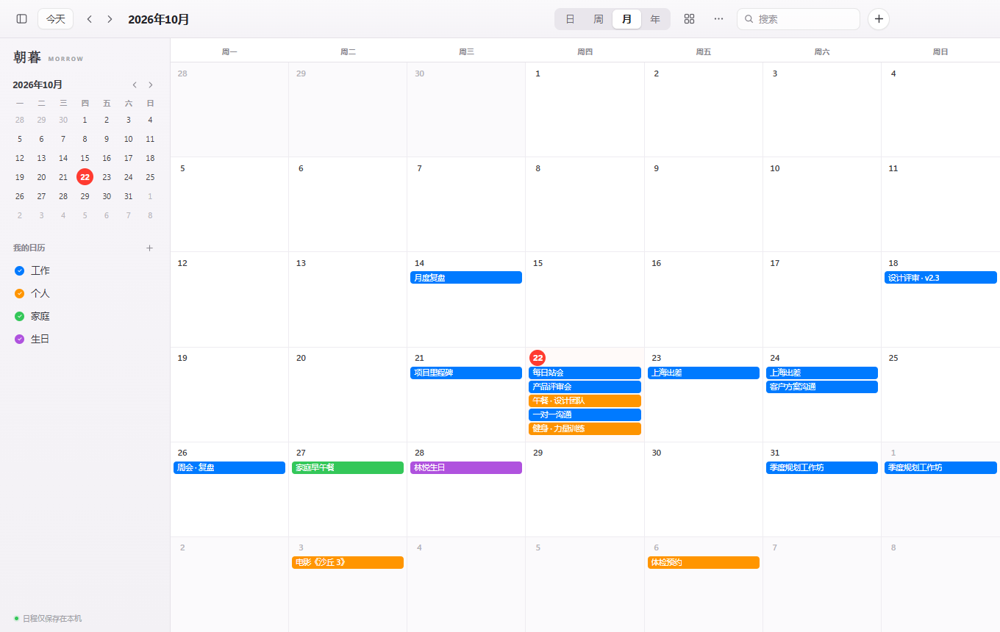
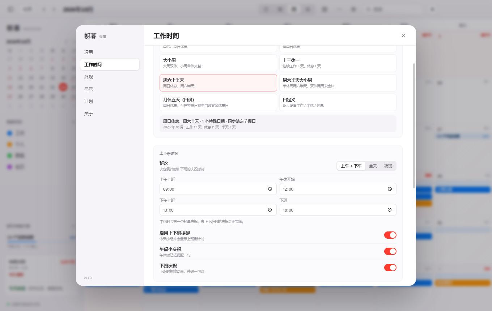
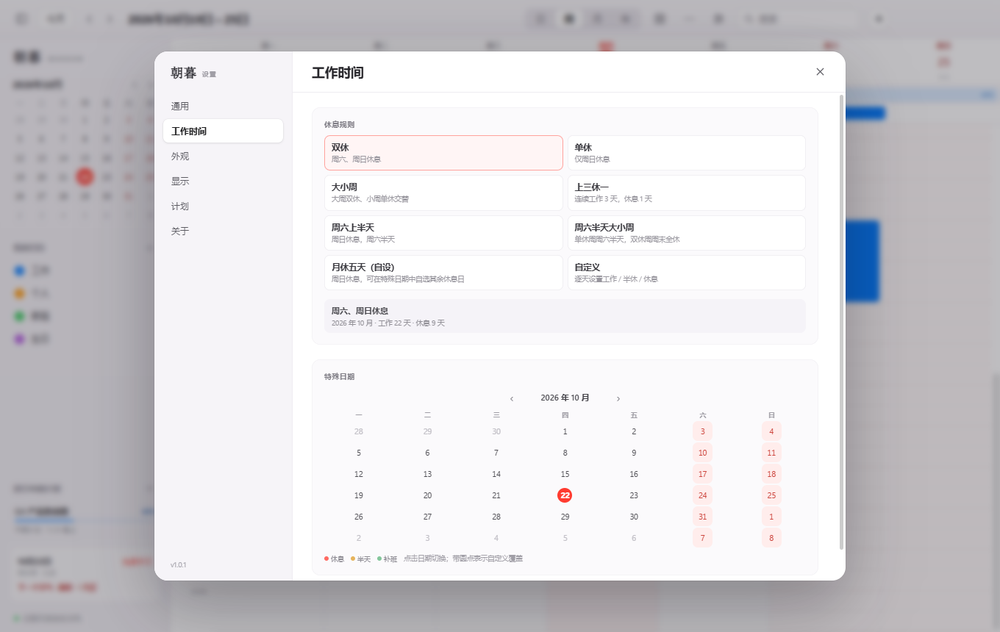
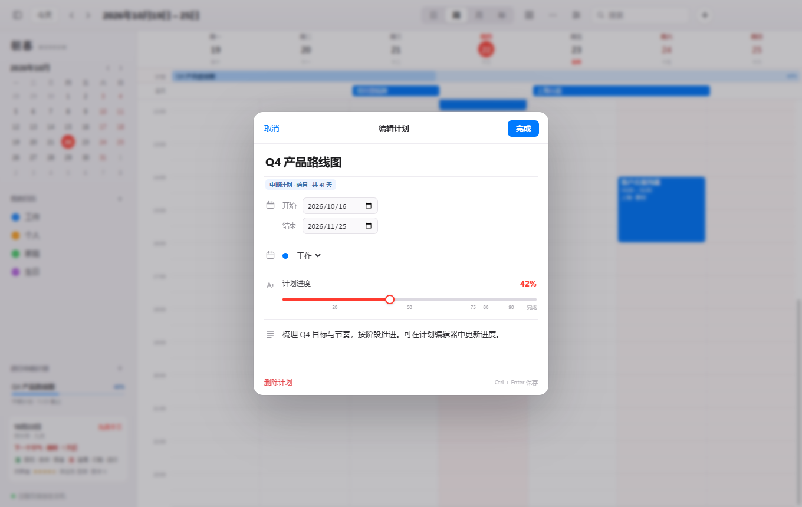
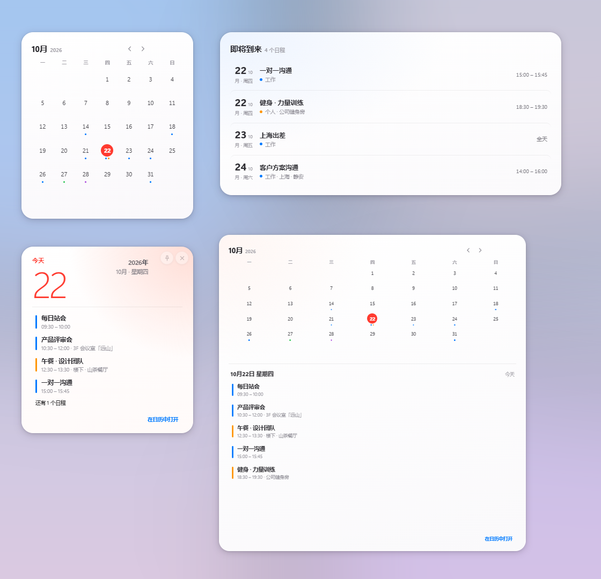
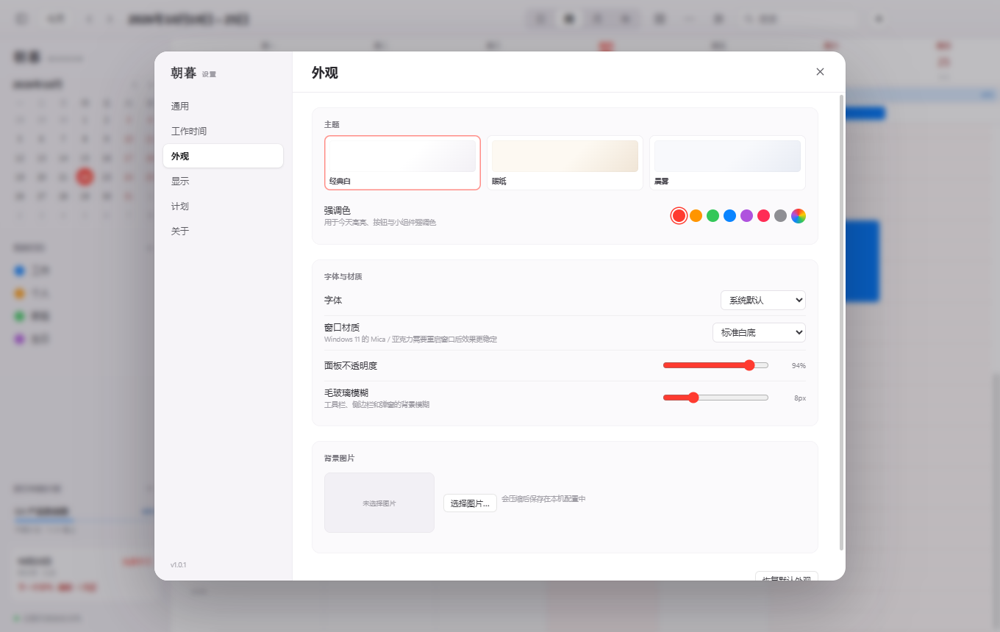

# Morrow · 朝暮


[](../../releases/latest)

> *Morrow* — the next day, the morning light.

**Morrow (朝暮)** is a macOS-inspired desktop calendar for Windows with four views, flexible recurring events, customizable work/rest rhythms and shift hours, long-running project plans, Chinese statutory holidays, four desktop widgets, and a full settings center. Local-first, built with Electron and vanilla JavaScript.

[中文](README.md) · [Offline HTML manual](README.html) · [GitHub](https://github.com/yaolongda/Morrow)



## Download

Get the latest Windows installer from **[Releases](../../releases/latest)**:

```text
朝暮-Morrow-Setup-1.2.1.exe
```

- Windows 10 / 11, x64
- Per-user install; no administrator privileges required
- Desktop and Start Menu shortcuts are created automatically
- Uninstall from Windows Settings; calendar data is preserved
- Unsigned build — if SmartScreen appears, choose **More info → Run anyway**

## Highlights

### Calendar

- Month, week, day and year views; all-day, multi-day and cross-month events.
- Drag a time range to create an event; double-click a month date for a quick event.
- Multiple color-coded calendars, show/hide, right-click rename/delete.
- Instant search across titles, locations and notes.
- Local-first JSON persistence with atomic writes.

### Recurring events

- Seven presets: **daily, every weekday, weekly (pick any days), every two weeks, monthly, quarterly, yearly**.
- Optional repeat end date; leave it empty to repeat indefinitely.
- When editing a recurring event, choose **This event**, **This and following**, or **All events**; deletion offers the same three scopes and keeps past history.
- Occurrences expand automatically in every view and in all four desktop widgets, marked with ↻.
- Search jumps to the next upcoming occurrence instead of the series' first date.

### Event reminders

- Set a reminder per event: 5 / 15 / 30 minutes, 1 hour, 1 day ahead, or a custom number of minutes.
- A gentle in-app card appears when due, with **Snooze 5 minutes** and **Open event**.
- Optionally also send a **Windows system notification**; reminders keep firing from the main process when the app is minimized to the tray.
- Everything is computed locally; nothing is uploaded.

### Daily essentials

- Stacked all-day events in week/day views collapse into "N more all-day events" and expand on click.
- **Ctrl+Z / Ctrl+Shift+Z** undo and redo event and plan changes.
- Deleted events and plans go to a **Recycle Bin** for 30 days, restorable in Settings → Recycle Bin.

### Shift hours and off-work celebrations

- Set the shift in **Settings → Work schedule**: **morning + afternoon**, **all day**, or **night shift**, with exact start/end times.
- The Today widget shows a live countdown to work, lunch, and the end of the day; on rest days it simply says "rest well".
- Lunch break gets a small, quiet celebration. Finishing work gets a fuller particle animation and a short poem.
- If tomorrow is a weekend or statutory holiday, the last workday celebration is upgraded automatically.
- Night shifts cross midnight; the celebration happens when the shift ends in the morning.
- Celebrations live only inside the Today widget — no system notifications, no interruptions.



### Chinese statutory holidays

- Bundled 2024–2026 holiday and make-up workday arrangements: holidays automatically become rest days, make-up days become workdays.
- Holiday names appear in the month view; the settings calendar marks them with a dot.
- Special-date overrides win: click a holiday and set it to "work" when you have to work through it.
- Import a community-maintained holiday JSON to extend 2027 and beyond; built-in data is preserved and can be restored.
- Holiday syncing can be turned off in Settings → Work schedule.

### Work rhythm

- Choose the week start: **Monday / Sunday / Saturday**.
- Rest-day presets: double day off, single day off, alternating big/small weeks, 3-on/1-off, Saturday half-day, Saturday half-day with alternating weekends, five days off per month (custom), or fully custom weekdays.
- Override any date as rest, half-day or work, for holidays and make-up days — individually or for a date range.
- Save shift setups as templates (A shift, B shift, night shift) and switch with one click.
- Rest days are softly highlighted across every calendar view, the mini calendar and all desktop widgets, and stay in sync.



### Long-running plans

- Plans have a start and end date and a progress value.
- Automatically classified and styled as **short (cross-week)**, **medium (cross-month)** or **long (cross-year)**.
- Subtle progress ribbons appear across the month; a dedicated plan band appears in week/day views.
- **Time-based progress**: new plans advance automatically with the calendar; switch it off to update progress by hand.
- **Custom reminder nodes**: add dates such as "first milestone review"; on the day, a gentle card with a poem appears — no system notification.
- Crossing **20 / 50 / 75 / 80 / 90 / 100%** triggers a short classical Chinese poem of encouragement; each milestone message can be customized.
- Archive finished plans and filter by **active / completed / archived** instead of deleting them.
- Gentle deadline reminders and an active-plan list (with today's node) in the sidebar.



### Desktop widgets

Month, Today, Upcoming, and Month & Agenda.

- Drag to move; **no fixed small/medium/large presets** — resize freely from the bottom-right grip or window edges.
- Layout adapts to size: month and agenda sit side by side when wide, stack when narrow; type scale and visible rows follow.
- Widgets follow the global theme, accent, font, panel opacity, blur, and background image, with subtle entrance animations.
- Multiple widgets of the same type are supported; each can override its theme, opacity and glass, and remembers its monitor.
- **Lock position and size** when done; pin above other windows or close. State survives restarts.
- The Today widget shows lunar date, solar term, work countdown, and plays an off-work celebration.
- Click a date or event to open it in the main calendar.

### How the widgets answer questions

All four widgets share one conclusion engine instead of interpreting data separately:

- **Today** answers "how long until I'm off, and what now": current rhythm, next commitment, remaining personal time, and an optional quiet suggestion.
- **Upcoming** answers "what's next, and where is the plan": ranked by conflict risk, preparation, plan nodes and proximity, with a hover reason and dual plan progress.
- **Month** answers "how busy is this month": one summary line plus density and a busiest-day marker.
- **Month & Agenda** answers "what's actually scheduled": the selected day's timeline, task count and empty state.

Time formats, conflict labels, task counts and progress language are identical across widgets. Within the last hour of work the Today widget breathes very slightly; there is no other persistent animation. Smart sorting, breathing and suggestions can each be turned off in Settings → Display → Widgets.


### More in 1.2

- **Multiple widgets & per-widget appearance**: open several of the same type (up to 10); each can override theme, opacity and glass, and remembers its monitor.
- **iCalendar**: import/export `.ics`, by calendar and date range, with UID de-duplication; fully local.
- **Tasks**: a lightweight today list in the sidebar plus an all-tasks panel with due dates and month-view markers.
- **Event templates, tag colors, note images**: save common events as templates, give an event its own color, and paste up to three images into notes.
- **ISO week numbers & history**: week numbers in month/week views, back/forward navigation with `Alt+←` / `Alt+→`.
- **Tray mini calendar**: click the tray icon for a mini month view, create an event or jump to a day.
- **Print & image export**: print the current view (or save as PDF) and export it as PNG.
- **Custom shortcuts**: remap today, views, new plan and prev/next.
- **Lunar enhancements**: almanac clash/direction, plus yearly lunar-birthday events.
- **Sharded storage**: above 2000 events, events are stored per year in `events/YYYY.json` and merged back automatically.



### Settings center

Open with the gear button or `Ctrl + ,`.

- **General**: week start, sidebar, config export/import, data folder.
- **Work schedule**: rest presets, custom weekdays, shift hours, statutory holiday sync, special-date overrides and overtime.
- **Appearance**: three themes, accent color, six font choices, Windows 11 Mica/Acrylic, panel opacity, glass blur, and a custom background image with opacity/blur/dim controls.
- **Display**: lunar date, 24 solar terms, almanac auspicious/inauspicious activities, zodiac fortune, plan visibility.
- **Plans**: plan types, active plans, create new.
- **About**: version, slogan, project homepage, update link.



## Shortcuts

| Shortcut | Action |
| --- | --- |
| `T` | Today |
| `D` / `W` / `M` / `Y` | Day / Week / Month / Year view |
| `←` / `→` | Previous / next range |
| `Ctrl + N` | New event |
| `P` | New plan |
| `Ctrl + F` or `/` | Search |
| `Ctrl + ,` | Settings |
| `Ctrl + Enter` | Save event / plan |
| `Ctrl + Z` / `Ctrl + Shift + Z` | Undo / redo event and plan changes |
| `Esc` | Close dialog / search |

## Build from source

```powershell
npm install
npm start
```

Optional mirror for slow Electron downloads:

```powershell
$env:ELECTRON_MIRROR = "https://npmmirror.com/mirrors/electron/"
$env:ELECTRON_BUILDER_BINARIES_MIRROR = "https://npmmirror.com/mirrors/electron-builder-binaries/"
npm install
```

Build:

```powershell
npm run dist
# dist\朝暮-Morrow-Setup-1.2.1.exe

npm run build:portable
# release\朝暮-win32-x64\朝暮.exe
```

## Data

```text
%APPDATA%\朝暮\
├─ calendar-data.json    # calendars, plans, settings and tasks
├─ events/YYYY.json      # event shards when above 2000 events
├─ widgets.json          # widget position, size, theme, display and lock
└─ window-state.json     # main window bounds
```

No network access, no telemetry. Uninstalling preserves the data directory.

## Tech

- Electron 45
- Vanilla HTML/CSS/JavaScript, no frontend framework, no runtime NPM dependencies
- Browser Intl Chinese calendar + solar-longitude solar terms
- Bundled Chinese statutory holiday data (chinese-days, MIT)
- Chromium DevTools Protocol end-to-end tests
- electron-builder + NSIS

## Tests

```powershell
npm test
npm run test:features
npm run test:widgets
```

98 automated checks: 23 core, 71 feature, 4 widget-restart. Coverage includes work/rest presets, statutory holidays and holiday JSON import, shift hours and celebration intensity, shift templates, batch date overrides, recurring events and lunar birthdays, event reminders and main-process scheduling, all-day collapse, undo/redo, recycle bin, plan auto-progress / archiving / cycles / custom milestones, iCalendar, tasks, templates, tag colors, week numbers, history navigation, widget multi-instance / per-widget appearance / conclusion-driven rhythm / smart sorting / dual progress / empty states / celebration animation, sharded storage, config import/export and restart persistence.

## Known limitations

- Almanac and zodiac content is generated locally for cultural/entertainment reference.
- Holiday data covers 2024–2026 (chinese-days, MIT); later years can be added by importing a holiday JSON, or supplemented with special dates.
- Mica/Acrylic requires Windows 11.
- The interface is Simplified Chinese; a full Traditional Chinese UI is not included yet.
- No sync or team sharing yet; system notifications are optional and require Windows support.
- The recycle bin keeps items for 30 days, then clears them automatically.
- Builds are unsigned.
- Widgets are separate windows and float above other apps when pinned.

## License

[MIT](LICENSE) © 2026 yaolongda

Inspired by Apple Calendar and macOS Sonoma widgets. Independent implementation, not affiliated with Apple.
