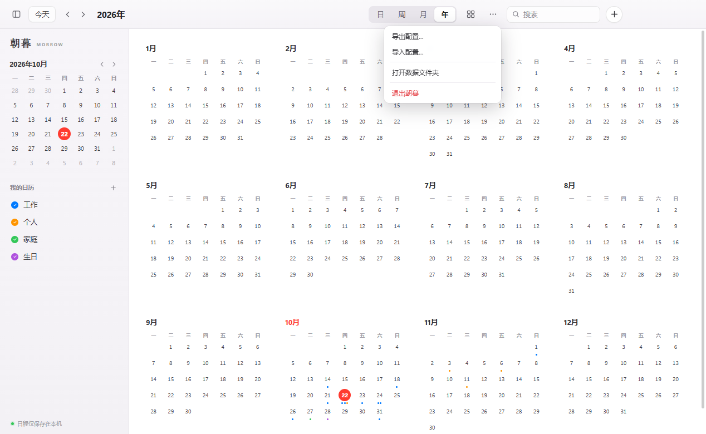

# 朝暮 · Morrow


[](../../releases/latest)

> 朝朝暮暮，皆有安排。

[English](README.en.md) · [离线 HTML 说明](README.html)

**朝暮（Morrow）** 是一款参考 macOS 日历设计的 Windows 桌面日历：月、周、日、年四种视图，支持拖拽创建日程、多日历配色、搜索，以及四种可拖拽、可置顶、实时同步的桌面小组件。所有数据只保存在本机。


## 下载

前往 **[Releases](../../releases/latest)** 下载最新 Windows 安装包：

```text
朝暮-Morrow-Setup-1.0.0.exe
```

- 系统要求：Windows 10 / 11（x64）
- 默认按当前用户安装，无需管理员权限；会创建桌面与开始菜单快捷方式
- 可在「设置 → 应用」中正常卸载，卸载不会自动删除日程数据
- 安装包未做代码签名；首次运行若出现 SmartScreen，请选择「更多信息 → 仍要运行」

> 安装包约 107 MB，超过 GitHub 普通仓库的单文件限制，因此作为 Release 附件发布，不放入源码仓库。

## 功能

- **四种视图**：月、周、日、年。今天高亮，支持跨月、全天与多日日程。
- **日程管理**：新建、编辑、删除；设置日历、开始/结束时间、全天、地点与备注。
- **快速创建**：周/日视图拖出时间区间即可新建；月视图双击日期快速创建；也可按 `Ctrl + N`。
- **多日历**：自定义名称与颜色，可单独显示/隐藏；右键日历可重命名或删除。
- **搜索**：按标题、地点、备注即时搜索，点击或回车打开结果。
- **配置备份与迁移**：`⋯` 菜单可导出/导入配置，包含日历、全部日程、界面设置与小组件布局；导入前会确认覆盖。
- **本地持久化**：JSON 原子写入，不依赖网络或账号。
- **桌面小组件**：月历、今天、即将到来、月历与议程四种尺寸；可拖动摆放、置顶、关闭，位置和置顶状态会被记住，并与主日历实时同步。


## 桌面小组件


- 小号月历：整月日期、日程圆点、月份切换。
- 小号今天：大号日期与今天的日程。
- 中号即将到来：接下来 4 个日程。
- 大号月历与议程：月历 + 选中日期的议程。
- 悬停出现置顶/关闭按钮；拖动卡片即可移动，位置自动保存。
- 默认不强制置顶，留在普通窗口后面；点击图钉可固定在其它窗口上方。
- 点击小组件里的日期或日程，会打开主日历并定位到对应位置。

## 配置导出与导入

点击工具栏右侧的 **⋯**：

- **导出配置…**：生成 `.json` 备份，包含日历、全部日程、界面设置和桌面小组件布局。
- **导入配置…**：先显示将被覆盖的日历、日程和小组件数量，确认后替换当前数据。
- 也兼容直接导入数据目录里的 `calendar-data.json`（这类文件不含小组件布局）。
- 导入前建议先导出当前配置作为兜底，此操作无法撤销。



## 从源码运行

```powershell
npm install
npm start
```

项目已内置 Electron。若重新安装时二进制下载缓慢，可先设置镜像：

```powershell
$env:ELECTRON_MIRROR = "https://npmmirror.com/mirrors/electron/"
$env:ELECTRON_BUILDER_BINARIES_MIRROR = "https://npmmirror.com/mirrors/electron-builder-binaries/"
npm install
```

## 构建安装包

```powershell
npm run dist
# 输出：dist\朝暮-Morrow-Setup-1.0.0.exe
```

生成免安装便携目录：

```powershell
npm run build:portable
# 输出：release\朝暮-win32-x64\朝暮.exe
```

## 使用说明

| 操作 | 方式 |
| --- | --- |
| 切换视图 | 顶部「日 / 周 / 月 / 年」 |
| 回到今天 | 左上角「今天」或按 `T` |
| 前后翻页 | 左上角 `‹` `›` 或 `←` `→` |
| 新建日程 | `+`、`Ctrl + N`、双击月视图日期，或在周/日视图拖出时间段 |
| 编辑日程 | 点击任意日程 |
| 搜索 | 顶部搜索框、`Ctrl + F` 或 `/` |
| 显示/隐藏日历 | 点击侧边栏中的日历名称 |
| 管理日历 | 在日历上右键重命名或删除 |

## 快捷键

| 快捷键 | 功能 |
| --- | --- |
| `T` | 回到今天 |
| `D` / `W` / `M` / `Y` | 日 / 周 / 月 / 年视图 |
| `←` / `→` | 上一个 / 下一个时间范围 |
| `Ctrl + N` | 新建日程 |
| `Ctrl + F` 或 `/` | 搜索 |
| `Ctrl + Enter` | 保存日程（编辑器打开时） |
| `Esc` | 关闭弹窗 / 搜索结果 |

## 数据与隐私

所有数据只保存在本机：

```text
%APPDATA%\朝暮\
├─ calendar-data.json    # 日历与日程
├─ widgets.json          # 桌面小组件布局、置顶状态
└─ window-state.json     # 主窗口大小与位置
```

- 应用不访问网络，不上传任何数据。
- 备份时复制 `calendar-data.json` 即可，或使用 `⋯ → 导出配置…` 一键备份全部内容。
- 删除 `calendar-data.json` 可恢复示例数据；卸载应用不会自动删除数据。
- 从旧版「日历」升级时，会自动迁移原有日程与小组件数据。

## 技术栈

- Electron 45
- 原生 HTML / CSS / JavaScript，无前端框架、无运行时 NPM 依赖
- Chromium DevTools Protocol 驱动的端到端测试
- electron-builder + NSIS 打包
- 本地 JSON 持久化，原子写入

## 项目结构

```text
.
├─ main.js                  # Electron 主进程：窗口、托盘、小组件、存储
├─ preload.js               # 安全的渲染进程桥接
├─ seed.js                  # 首次启动示例数据
├─ renderer/
│  ├─ index.html            # 主窗口结构
│  ├─ styles.css            # 主界面样式
│  ├─ app.js                # 日历渲染与交互
│  ├─ widget.html           # 小组件容器
│  ├─ widget.css            # 小组件样式
│  └─ widget.js             # 小组件渲染与同步
├─ assets/                  # 应用与托盘图标
├─ docs/                    # 截图、发布文案与说明
├─ tools/
│  ├─ e2e.js                # 端到端功能测试（CDP 驱动）
│  ├─ widget-restart-test.js
│  ├─ build_portable.ps1    # 便携版构建
│  ├─ make_icon.py          # 生成图标
│  ├─ make_showcase.py      # 生成小组件展示图
│  └─ build_readme.py       # 生成自包含 README.html
├─ .github/workflows/release.yml
├─ README.md / README.en.md / README.html
├─ RELEASE_NOTES.md
└─ LICENSE
```

## 测试

使用真实 Electron 窗口做自动化验收：

```powershell
npm test
npm run test:widgets
```

覆盖新建/删除日程、落盘、搜索、日历显隐、新建日历、周视图拖拽建日程、配置导出/导入与覆盖确认、配置导入恢复小组件布局、小组件添加/置顶/关闭、四种小组件不重叠、主日历修改实时同步、小组件重启恢复等 **27 项检查**。

## 已知边界

- 当前只提供浅色主题；暂无重复日程、提醒通知、账户与云同步。
- 周起始日固定为周一。
- 小组件是独立窗口，置顶时会覆盖其它应用；不置顶时随普通窗口层级变化。
- 安装包与便携版未签名，Windows SmartScreen 可能给出提示。

## License

[MIT](LICENSE) © 2026 yaolongda

参考设计：Apple Calendar / macOS Sonoma 桌面小组件。本项目为独立实现，与 Apple 无关。
